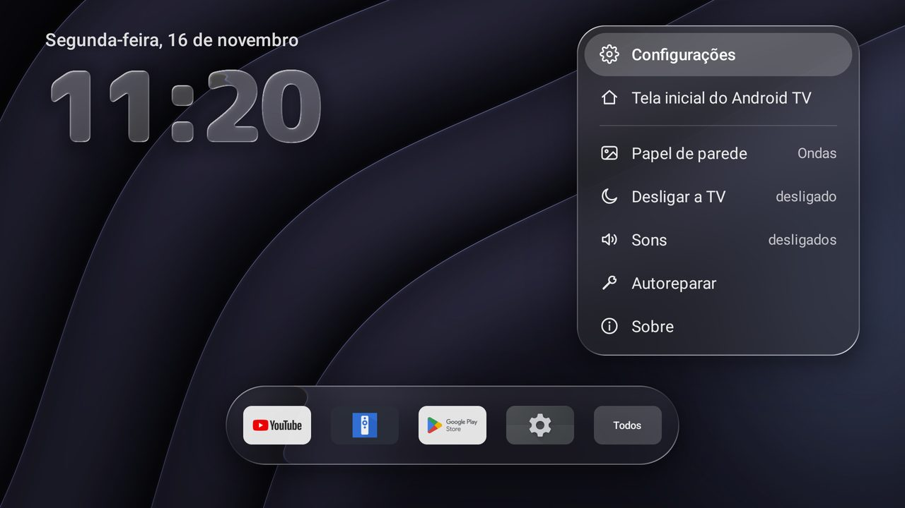
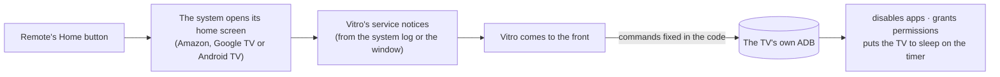
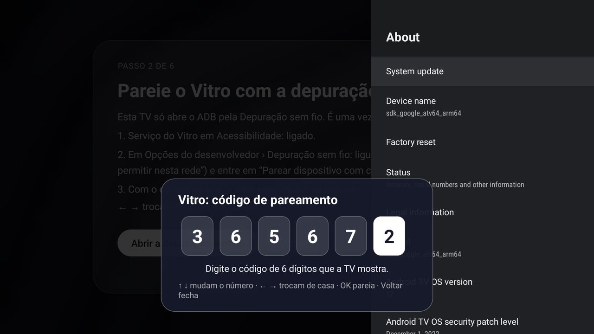

# Vitro

**A glass home screen for Fire TV, Android TV and Google TV** that also makes the device lighter: the Home button
opens Vitro, and the system's ad, recommendation and telemetry apps are carefully disabled, never deleted.

Everything runs on the TV itself. Vitro has no server, sends no data anywhere and needs no root.

> A project by a Brazilian enthusiast who just wanted to fix a problem with their own TV, and decided to share the
> fix with the world.

*Português: [README.md](README.md)* (the full guide, with more screenshots). The app speaks English and
Portuguese: it follows the TV's language, and you can switch in Home › Vitro settings › About.

## Where it works

Vitro detects which system it is on (Fire OS, Google TV or Android TV) and uses what each one needs: the home
screen the Home button opens, the list of apps to disable, and how to reach the TV's own ADB.

**Key:** ✅ tested · 🟢 should work (same system as tested) · 🟡 partly works or not tested yet · ❌ does not run.

### Fire TV

| | Devices | System |
|---|---|---|
| ✅ | **Fire TV Stick 3rd gen** (AFTSSS), where Vitro was born | Fire OS 7.7 (Android 9) |
| 🟢 | Fire TV Stick Lite, Fire TV Stick HD (2024), Fire TV Stick 4K Max (1st gen), Fire TV Cube (2nd and 3rd gen), Fire TV smart TVs from 2019 to 2023 | Fire OS 7 (Android 9) |
| 🟡 | Fire TV Stick 4K (2nd gen), 4K Max (2nd gen, 2023), Fire TV Stick 4K Plus (2025), Fire TV smart TVs from 2024 | Fire OS 8 (Android 10/11): the Home button uses the Android 10+ path, tested only on Android TV; the local VPN is untested there |
| 🟡 | Fire TV Stick 4K (1st gen, 2018), Fire TV Cube (1st gen) | Fire OS 6 (Android 7.1): untested |
| 🟡 | Fire OS 14 smart TVs (TCL and Hisense, 2025–2026) | Android 14: untested; expected to behave like Google TV 14 (below) |
| ❌ | Fire TV Stick 4K Select (2025), Fire TV Stick HD (2026), Fire TV Stick 4K (3rd gen, 2026) | **Vega OS**: does not run Android apps |
| ❌ | Fire TV Stick 1st and 2nd gen, Basic Edition | Fire OS 5 (Android 5.1): too old to promise anything |

### Android TV and Google TV

Up to Android 12, the TV's ADB usually accepts network connections on **port 5555** once USB debugging (or
"Network debugging") is on. On Android 13 and 14 many devices only offer **Wireless debugging** with a pairing code:
Vitro pairs with it once, through a panel shown on top of Settings (see [Pairing](#android-13-and-14-pairing)).

| | Devices | System |
|---|---|---|
| ✅ | Android Studio's Android TV emulator | Android TV 12 |
| 🟢 | **Nvidia Shield** (all), with "Network debugging" on | Android 11 |
| 🟢 | Chromecast with Google TV still on Android 12; Google TV and Android TV sets on Android 10 to 12 (**TCL**, Sony, Philips, Hisense) that open port 5555 with debugging | Android 10–12 |
| 🟡 | Chromecast with Google TV updated to Android 14, **Google TV Streamer**, onn 4K, Xiaomi TV Box S (3rd gen), recent Google TV sets | Android 13–14, through **Wireless debugging**: Vitro pairs once and turns debugging back on by itself when the TV starts. Pairing and the TLS link were checked against Android's own ADB on the emulator; not yet tested on a real TV. Wireless debugging only works on Wi-Fi (not Ethernet) |
| ❌ | **Samsung** (Tizen), LG (webOS), Roku TVs (including TCL Roku TV), Apple TV | Not Android: they cannot install APKs |

## How it works

- **Home button:** an accessibility service notices when the system opens its home screen and brings Vitro to the
  front in under half a second. The system home screen stays installed and enabled, and you can open it from
  Vitro's menu.
- **The TV's own ADB:** Android does not let a regular app disable system apps; the ADB shell can. Vitro has a
  minimal ADB client and talks to the TV's own ADB with a key created on the TV that never leaves it.
  - On **Android TV and Google TV** it connects directly (127.0.0.1:5555) or, on Android 13 and 14 TVs, through
    **Wireless debugging** (TLS 1.3) after pairing once.
  - On **Fire OS**, Amazon refuses ADB connections that start on the device itself, so Vitro uses a **local VPN**
    that only exists inside the TV. Nothing leaves it, and your internet does not go through it.
- **From Android 13**, a background app can no longer read the system log, so Vitro reads it through the TV's own
  ADB. Without ADB, it notices Home from the home screen's window, a moment later.
- **Debloat with a guard:** apps are disabled with `pm disable-user`, never deleted. If a system update brings them
  back, Vitro disables them again. An app you re-enable yourself stays enabled.

## Install

1. **Turn on developer options.**
   - Fire TV: Settings › My Fire TV › About › press OK **7 times** on the device name, then turn on ADB debugging
     in Developer options.
   - Google TV: Settings › System › About › press OK **7 times** on "Android TV OS build", then turn on USB
     debugging (and Network debugging, if listed) in System › Developer options.
   - Android TV: Settings › Device Preferences › About › press OK **7 times** on "Build", then turn on USB debugging
     (and Network debugging, if listed; the Shield needs it) in Developer options.
2. **Install the APK**, using one of these:
   - the Downloader app, after allowing it to install unknown apps;
   - the Send Files to TV app;
   - a computer: `adb connect TV-IP:5555`, then `adb install vitro.apk`.
3. **Open Vitro.** First-run setup opens by itself.

## First-run setup

| Step | Who | What |
|---|---|---|
| 1 | You | Turn on debugging, if it is off (Vitro shows the path for your system). |
| 2 | You | **Fire OS only** (or if direct ADB does not answer): allow Vitro's local VPN. On Android 13/14 TVs without port 5555, pair with Wireless debugging instead. |
| 3 | You | Approve Vitro's key in the "Allow USB debugging?" prompt. Tick **"Always allow"**: if the TV does not keep it, Vitro says so and asks again. |
| 4 | Vitro, with your OK | Disables apps: the recommended ones, the recommended ones plus a few more, or the ones you tick in the **checkup**, which measures memory use right now. |
| 5 | Vitro, with your OK | **Fire OS only**: Prime Video on demand, or not. |
| 6 | Vitro | Grants itself the permissions to read the system log and change settings, turns on the Home button service and restarts. |

The full Portuguese guide shows every screen: [README.md](README.md#primeira-configura%C3%A7%C3%A3o).

## Android 13 and 14: pairing

When port 5555 is closed, setup swaps the VPN step for **pairing with Wireless debugging**. You do it once:

1. Vitro's service must be on in Settings › Accessibility (it draws the code panel).
2. In Developer options › **Wireless debugging**, turn it on (tick "Always allow on this network") and open
   **Pair device with pairing code**.
3. With the code on screen, Vitro shows a panel at the bottom, on top of Settings. Type the code with the arrows
   (↑ ↓ change the digit, ← → move; the remote's number keys work too) and press OK.

After that, Vitro talks to the TV's ADB over TLS with a key that never leaves the TV. Wireless debugging turns off
when the TV restarts; Vitro turns it back on by itself, silently, on the network where you ticked "Always allow".
Pairing uses the same protocol as the computer's `adb pair` (TLS 1.3, SPAKE2 and AES-GCM), written in Java inside
Vitro with no third-party libraries.

## What gets disabled on each system

- **Fire OS:** [`launcher/debloat.txt`](launcher/debloat.txt). Amazon ads, recommendations, telemetry and extras.
  Alexa and voice control are never disabled.
- **Android TV and Google TV:** [`launcher/debloat-androidtv.txt`](launcher/debloat-androidtv.txt). Home screen
  recommendations and ads, reports sent to Google, ambient mode with promoted content and, on **TCL** sets, TCL's
  own content, ad and data collection apps. The Assistant and voice search are never disabled. Never touched
  either: Play Store and Google services, the setup wizard, HDMI inputs, the tuner and live TV, picture and sound
  settings, the remote, the keyboard and the system home screens.

## Undo

- **One app:** Settings › Apps › the app › Enable, or `adb shell pm enable <package>`.
- **Home button:** Settings › Accessibility › Vitro › off. Self-repair turns it back on when the TV starts; to turn
  it off for good, uninstall Vitro.
- **Everything:** uninstall Vitro. Revoke the key in Developer options › Revoke USB debugging authorizations.
  Disabled apps stay disabled until you enable them.

## Build

Java 17 and the Android SDK (`platforms;android-34`, `build-tools;34.0.0`), no Gradle: `cd launcher && sh build.sh`.
The APK lands in `launcher/out/vitro.apk`. The first build creates a signing key in `launcher/key.jks`. Keep it,
because updates need the same key, and never commit it.

## License

[MIT](LICENSE): use, modify and redistribute freely, keeping the copyright notice. Vitro comes with no warranty: it
disables system apps, and each person decides what to disable on their own TV. Third-party credits and licenses are
in [THIRD_PARTY_NOTICES.md](THIRD_PARTY_NOTICES.md).
