# Vitro

**Tela inicial de vidro para Fire TV, Android TV e Google TV**, que também deixa o aparelho mais leve: o botão
Home passa a abrir o Vitro, e os apps de anúncios, recomendações e telemetria do sistema ficam desativados, com
cuidado e sem apagar nada.

Tudo roda na própria TV. O Vitro não tem servidor, não manda dados para fora e não precisa de root.

> Um projeto de um entusiasta brasileiro, que só queria resolver um problema da própria televisão e resolveu
> dividir a solução com o mundo.

**Como instalar: [INSTALAR.md](INSTALAR.md). Como usar, botão por botão: [Tutorial](TUTORIAL.md).** *English: [README.en.md](README.en.md).* O app fala português e inglês: segue o idioma da TV, e dá para trocar em
Home › ajustes do Vitro › Sobre.

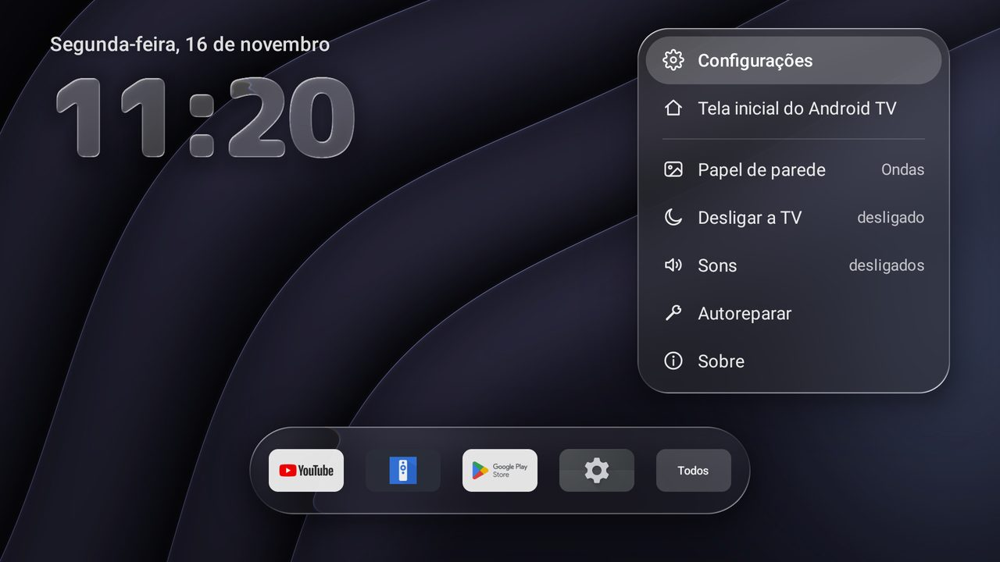

## Sumário

1. [Onde funciona](#onde-funciona)
2. [Como funciona](#como-funciona)
3. [Instalar](#instalar)
4. [Primeira configuração](#primeira-configura%C3%A7%C3%A3o)
5. [Usando o Vitro](#usando-o-vitro)
6. [O que é desativado em cada sistema](#o-que-%C3%A9-desativado-em-cada-sistema)
7. [Desfazer](#desfazer)
8. [Desligar a TV pela voz (Fire TV)](#desligar-a-tv-pela-voz-fire-tv)
9. [Apoie o projeto](#apoie-o-projeto)
10. [Compilar](#compilar), [Créditos](#cr%C3%A9ditos) e [Licença](#licen%C3%A7a)

## Onde funciona

O Vitro reconhece sozinho em que sistema está (Fire OS, Google TV ou Android TV) e usa o que cada um precisa: a
tela inicial que o Home abre, a lista de apps para desativar e o jeito de falar com o ADB da própria TV.

**Legenda:** ✅ testado · 🟢 deve funcionar (mesmo sistema do que foi testado) · 🟡 funciona em parte ou ainda não
foi testado · ❌ não roda.

### Fire TV

| | Aparelhos | Sistema |
|---|---|---|
| ✅ | **Fire TV Stick 3ª geração** (AFTSSS), onde o Vitro nasceu | Fire OS 7.7 (Android 9) |
| 🟢 | Fire TV Stick Lite, Fire TV Stick HD (2024), Fire TV Stick 4K Max (1ª geração), Fire TV Cube (2ª e 3ª geração), TVs Fire TV de 2019 a 2023 | Fire OS 7 (Android 9) |
| 🟡 | Fire TV Stick 4K (2ª geração), 4K Max (2ª geração, 2023), Fire TV Stick 4K Plus (2025), TVs Fire TV de 2024 em diante | Fire OS 8 (Android 10/11): o botão Home usa o caminho do Android 10+, testado só no Android TV; a VPN local ainda não foi testada nele |
| 🟡 | Fire TV Stick 4K (1ª geração, 2018), Fire TV Cube (1ª geração) | Fire OS 6 (Android 7.1): não testado |
| 🟡 | TVs com Fire OS 14 (TCL e Hisense de 2025 e 2026) | Android 14: não testado; deve se comportar como o Google TV 14 (abaixo) |
| ❌ | Fire TV Stick 4K Select (2025), Fire TV Stick HD (2026), Fire TV Stick 4K (3ª geração, 2026) | **Vega OS**: não roda apps Android |
| ❌ | Fire TV Stick 1ª e 2ª geração, Fire TV Stick Basic Edition | Fire OS 5 (Android 5.1): antigo demais para garantir |

### Android TV e Google TV

Até o Android 12, o ADB da TV costuma aceitar conexão pela rede na **porta 5555** assim que a Depuração USB (ou
"Depuração pela rede") é ligada. No Android 13 e 14 muitos aparelhos só oferecem a **Depuração sem fio**, com código
de pareamento: o Vitro pareia com ela uma vez, com um painel por cima das Configurações (veja
[Pareamento](#tvs-com-android-13-e-14-pareamento)).

| | Aparelhos | Sistema |
|---|---|---|
| ✅ | Emulador de Android TV do Android Studio | Android TV 12 |
| 🟢 | **Nvidia Shield** (todos), com "Depuração pela rede" ligada | Android 11 |
| 🟢 | Chromecast com Google TV que ainda está no Android 12; TVs Google TV e Android TV com Android 10 a 12 (**TCL**, Sony, Philips, Hisense) que abrem a porta 5555 com a depuração | Android 10 a 12 |
| 🟡 | Chromecast com Google TV atualizado para o Android 14, **Google TV Streamer**, onn 4K, Xiaomi TV Box S (3ª geração), TVs Google TV recentes | Android 13 e 14, pela **Depuração sem fio**: o Vitro pareia uma vez e religa a depuração sozinho quando a TV liga. Pareamento e conexão conferidos contra o ADB do Android no emulador; falta testar numa TV de verdade. A depuração sem fio só funciona no Wi-Fi (não no cabo de rede) |
| ❌ | **Samsung** (Tizen), LG (webOS), TVs Roku (inclusive as TCL Roku TV), Apple TV | Não são Android: não instalam APK |

> As TVs da Samsung usam o Tizen, sistema próprio da Samsung, e não rodam apps Android. Nelas não dá para usar o
> Vitro nem fazer este debloat.

## Como funciona

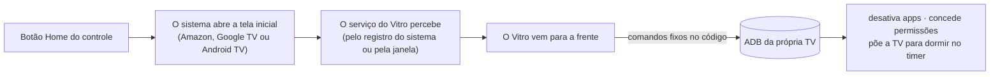

- **Botão Home:** um serviço de acessibilidade do Vitro percebe quando o sistema abre a tela inicial dele e põe o
  Vitro na frente, em menos de meio segundo. A tela inicial do sistema continua instalada e ligada: dá para
  abri-la pelo menu do Vitro, e nada quebra no sistema.
- **ADB da própria TV:** o Android não deixa um app comum desativar apps do sistema. O shell do ADB pode. O Vitro
  tem um cliente ADB mínimo e conversa com o ADB da própria TV, com uma chave criada na TV que nunca sai dela.
  - No **Android TV e Google TV**, ele conecta direto (127.0.0.1:5555) ou, nas TVs com Android 13 e 14, pela
    **Depuração sem fio** (TLS 1.3), depois de parear uma vez.
  - No **Fire OS**, a Amazon recusa conexões ADB que começam no próprio aparelho, então o Vitro usa uma **VPN
    local**, que só existe dentro da TV: nada sai dela, e a sua internet não passa por ela.
- **Do Android 13 em diante**, um app em segundo plano não lê mais o registro do sistema. O Vitro então lê o
  registro pelo próprio ADB da TV; sem ele, percebe o Home pela janela da tela inicial, um instante depois.
- **Debloat com guarda:** os apps são desativados com `pm disable-user`, nunca apagados. Se uma atualização do
  sistema os trouxer de volta, o Vitro os desativa de novo. Um app que você reativar por conta própria fica ativo.
- **Autorreparo:** se uma atualização desligar o serviço do botão Home, a depuração ou as permissões, o Vitro os
  religa quando a TV liga. O menu **Autoreparar** faz a mesma conferência na hora.

## Instalar

**Guia passo a passo, do jeito mais fácil (o app Downloader, só com o controle) ao mais trabalhoso: [INSTALAR.md](INSTALAR.md).** Abaixo, o resumo.

### 1. Ligue as opções do desenvolvedor

| Sistema | Caminho |
|---|---|
| Fire TV | Configurações › Minha Fire TV › Sobre › aperte OK **7 vezes** sobre o nome do aparelho. Depois, em Opções do desenvolvedor, ligue **Depuração ADB** |
| Google TV | Configurações › Sistema › Sobre › aperte OK **7 vezes** sobre "Build do SO do Android TV". Depois, em Sistema › Opções do desenvolvedor, ligue **Depuração USB** (e "Depuração pela rede", se aparecer) |
| Android TV | Configurações › Preferências do dispositivo › Sobre › aperte OK **7 vezes** sobre "Build". Depois, em Preferências do dispositivo › Opções do desenvolvedor, ligue **Depuração USB** (e "Depuração pela rede", se aparecer; no Shield ela é necessária) |

Os nomes mudam um pouco de um fabricante para outro. A primeira configuração do Vitro mostra o caminho certo
para o sistema que ela encontrou.

### 2. Instale o APK

Escolha um jeito:

- **Pelo app Downloader** (Fire TV, e na Play Store do Google TV): permita que ele instale apps (Fire TV: Opções
  do desenvolvedor › Instalar apps desconhecidos; Google TV: Configurações › Apps › Segurança e restrições ›
  Fontes desconhecidas) e abra o endereço do `vitro.apk` na página de versões (Releases) deste repositório.
- **Pelo app Send Files to TV**, do celular para a TV.
- **Pelo computador**, com o [Android Platform Tools](https://developer.android.com/tools/releases/platform-tools):

  ```
  adb connect IP-DA-TV:5555
  adb install vitro.apk
  ```

### 3. Abra o Vitro

Abra o Vitro na lista de apps. A **primeira configuração** abre sozinha.

## Primeira configuração

A tela guia você pelo que só você pode fazer e faz o resto pelo ADB da própria TV. Leva uns 3 minutos.

| Passo | Quem faz | O quê |
|---|---|---|
| 1 | Você | Liga a depuração, se ainda estiver desligada (o Vitro mostra o caminho do seu sistema). |
| 2 | Você | **Só no Fire OS** (ou se o ADB direto não responder): permite a VPN local do Vitro. Nas TVs com Android 13 e 14 sem a porta 5555, pareia com a Depuração sem fio no lugar disso. |
| 3 | Você | Autoriza a chave do Vitro no aviso "Permitir depuração USB?". Marque **"Sempre permitir"**: se a TV não guardar, o Vitro avisa e pede de novo. |
| 4 | Vitro, com o seu OK | Desativa apps: os recomendados, os recomendados e mais alguns, ou os que você marcar no **diagnóstico**. |
| 5 | Vitro, com o seu OK | **Só no Fire OS**: deixa ou não o Prime Video sob demanda. |
| 6 | Vitro | Concede a si as permissões de ler o registro do sistema e de mudar ajustes, liga o serviço do botão Home e reinicia. |

Se você escolher "Agora não", ela volta pelo menu **Autoreparar**.

### No Android TV e no Google TV

| | |
|---|---|
| 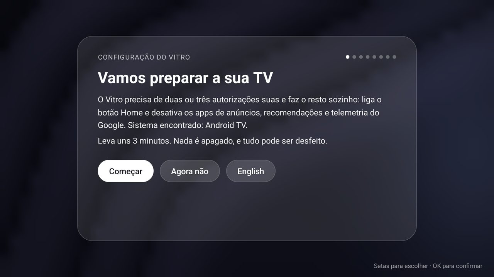 | 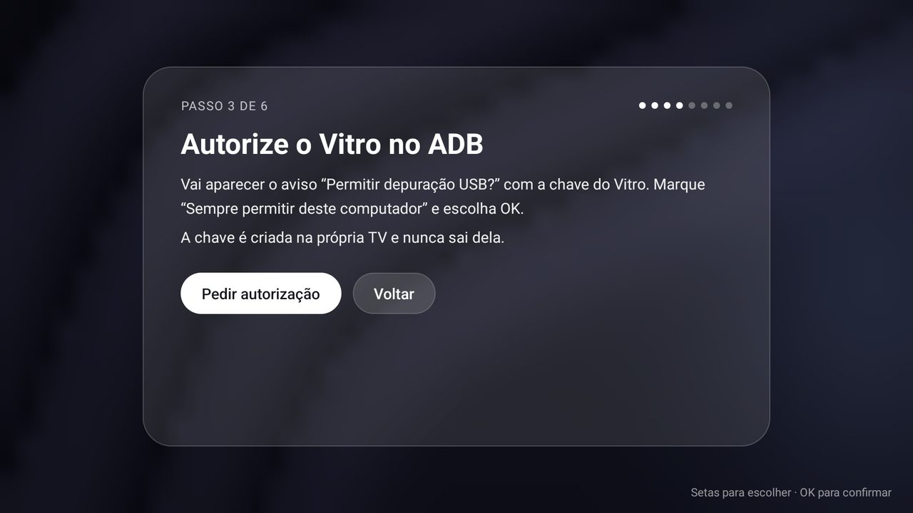 |
| **Boas-vindas.** O Vitro diz qual sistema encontrou. Como o ADB respondeu direto, a VPN nem é pedida. | **A chave do Vitro.** Aparece o aviso "Permitir depuração USB?": marque "Sempre permitir". |
| 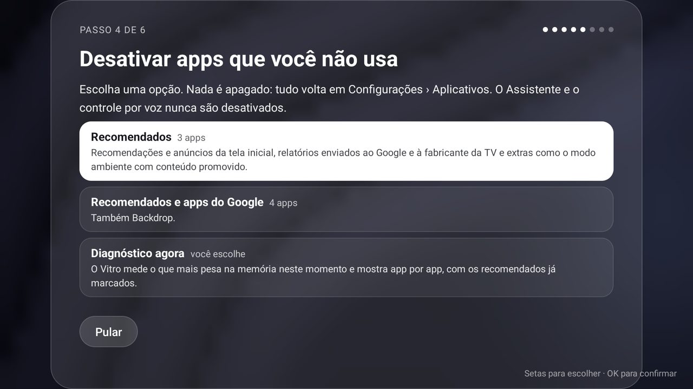 | 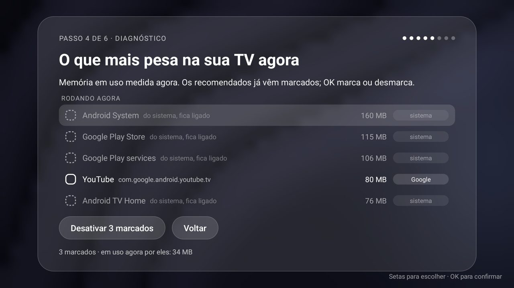 |
| **Os apps.** Três cartões: os recomendados, os recomendados e alguns apps do Google, ou o diagnóstico. | **Diagnóstico.** Mede na hora a memória de cada app. Os do sistema aparecem apagados, sem caixa. |
| 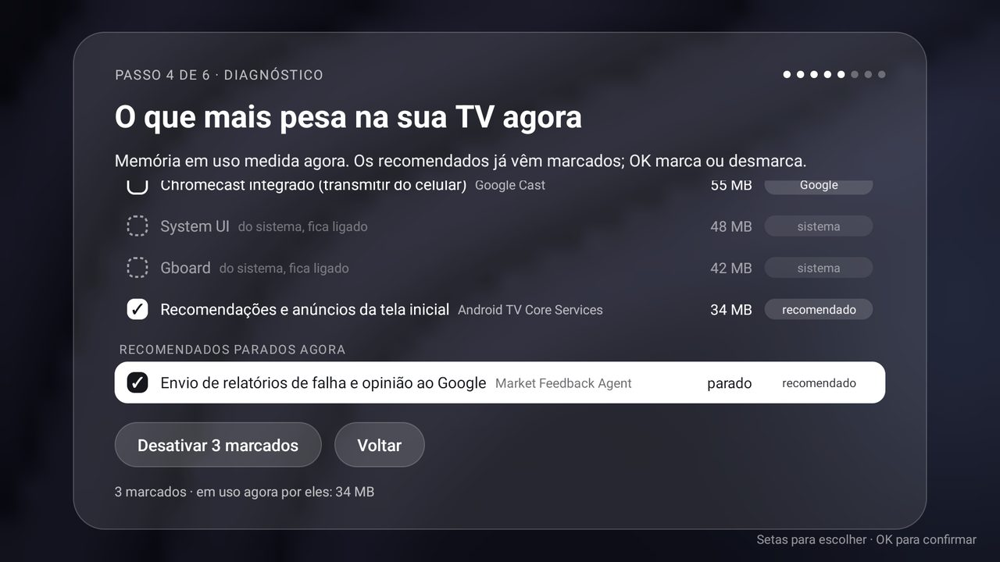 | 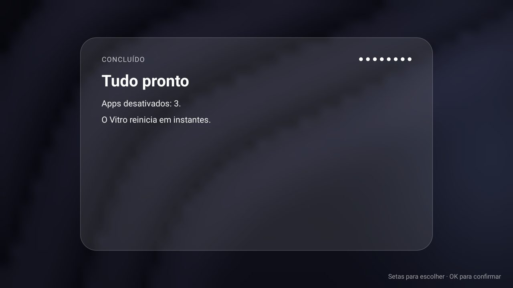 |
| **Recomendados já marcados.** OK marca ou desmarca cada um. | **Tudo pronto.** O Vitro reinicia, e o botão Home passa a abri-lo. |

### TVs com Android 13 e 14: pareamento

Quando a porta 5555 está fechada, a configuração troca a VPN pelo **pareamento com a Depuração sem fio**. É uma vez só:

1. O serviço do Vitro precisa estar ligado em Configurações › Acessibilidade (é ele que mostra o painel do código).
2. Em Opções do desenvolvedor › **Depuração sem fio**, ligue (marque "Sempre permitir nesta rede") e entre em
   **Parear dispositivo com código de pareamento**.
3. Com o código na tela, o Vitro abre um painel embaixo, por cima das Configurações. Digite o código com as setas
   (↑ ↓ mudam o número, ← → trocam de casa; os números do controle também servem) e aperte OK.

| | |
|---|---|
| 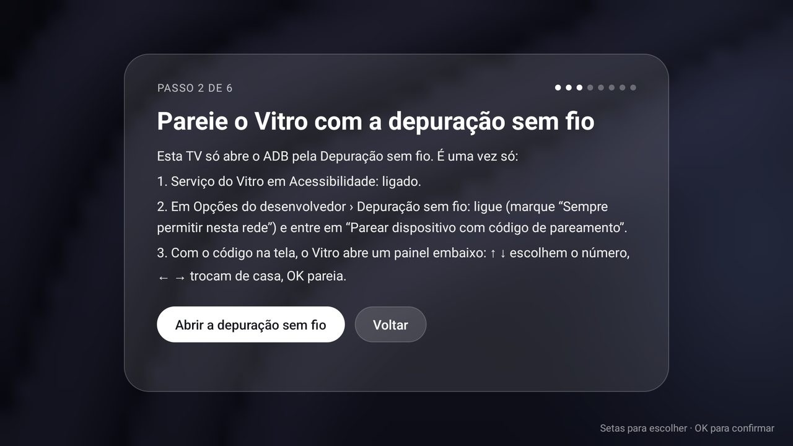 | 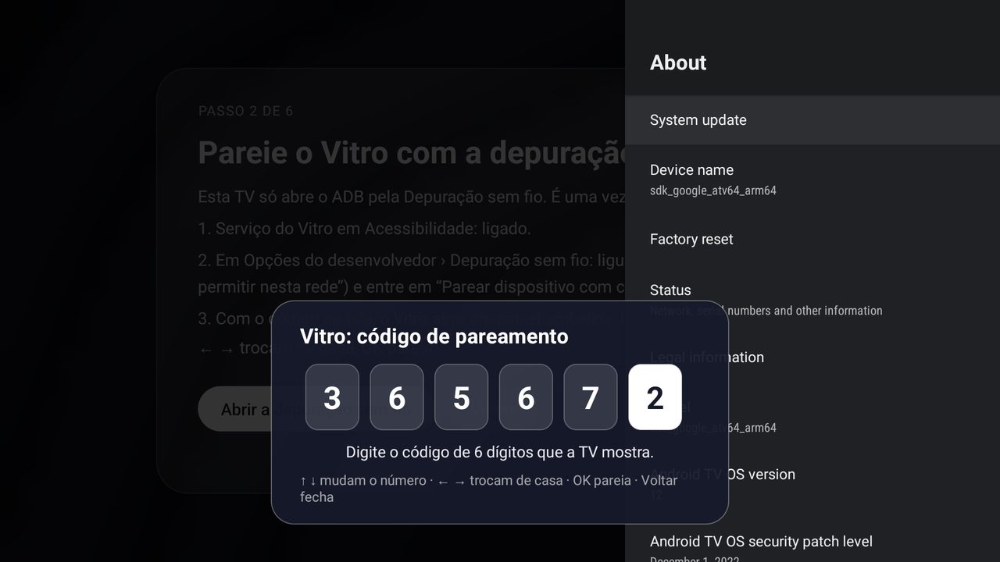 |
| **O passo do pareamento** aparece sozinho quando a TV só tem a depuração sem fio. | **O painel do código.** As Configurações continuam abertas atrás, com o código valendo. |

Depois disso, o Vitro conversa com o ADB da TV por TLS, com uma chave que nunca sai dela. A depuração sem fio
desliga quando a TV reinicia; o Vitro a religa sozinho, sem perguntar, na rede em que você marcou "Sempre permitir".
O pareamento usa o mesmo protocolo do `adb pair` do computador (TLS 1.3, SPAKE2 e AES-GCM), escrito em Java dentro
do Vitro, sem bibliotecas de fora.

### No Fire TV

| | |
|---|---|
| 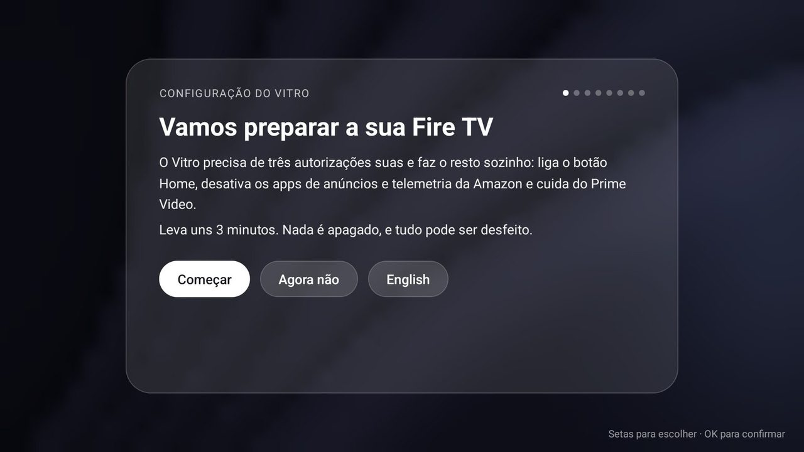 | 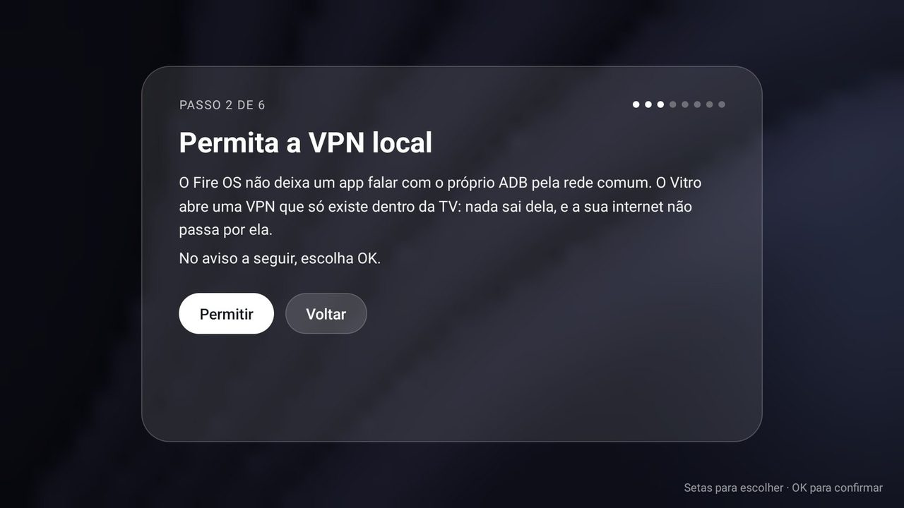 |
| **Boas-vindas.** No Fire OS são três autorizações. | **VPN local.** Só existe dentro da TV, para o Vitro alcançar o ADB dela. |
| 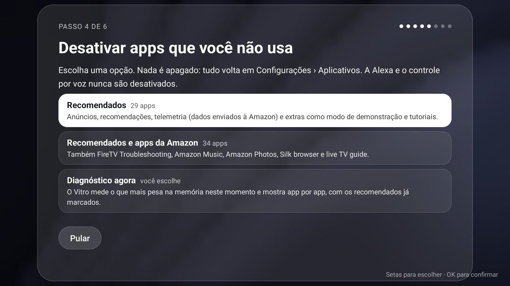 | 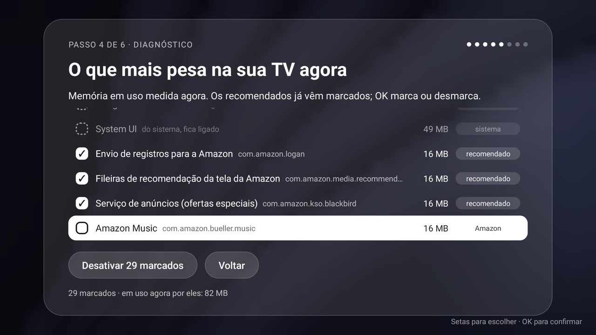 |
| **Os apps da Amazon.** Recomendados (29) ou recomendados e apps da Amazon (34). | **Diagnóstico.** Os recomendados da Amazon já vêm marcados. |

As capturas do Fire TV foram tiradas no emulador, com apps vazios no lugar dos da Amazon. Por isso eles aparecem
com poucos MB e os avisos do sistema estão em inglês.

## Usando o Vitro

| | |
|---|---|
| 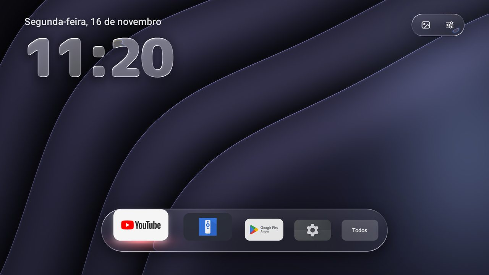 | 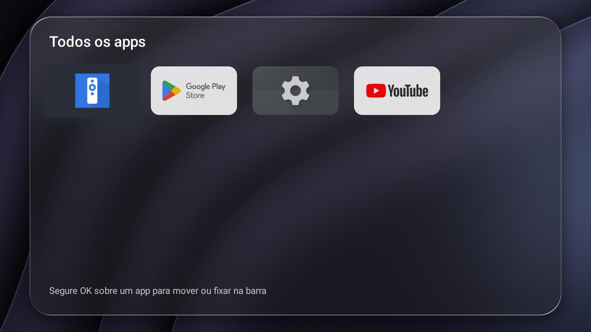 |
| **Tela inicial.** Relógio de vidro e a barra de apps. Segure OK sobre um app para mover ou tirar da barra. | **Todos os apps.** O último item da barra abre a gaveta com tudo o que está instalado. |
|  | 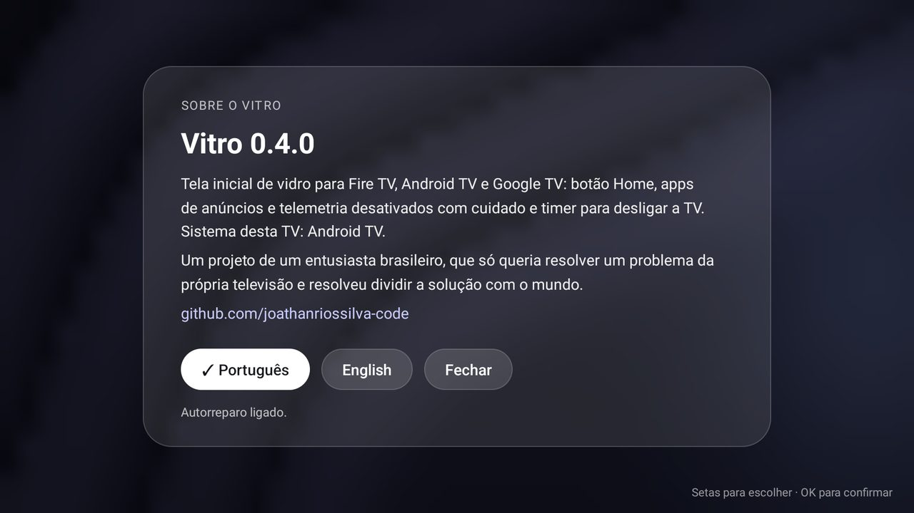 |
| **Ajustes** (o ícone no canto de cima). | **Sobre.** Versão, créditos, idioma e o QR Code para apoiar o projeto. |

O menu de ajustes tem estas linhas:

- **Configurações:** as do sistema.
- **Tela inicial do sistema:** abre a da Amazon, do Google TV ou do Android TV. O Vitro não a troca de volta
  enquanto você estiver nela.
- **Papel de parede:** cada OK passa para o próximo.
- **Desligar a TV:** timer de 15, 30, 60 ou 90 minutos, com aviso um minuto antes. Se a TV aceita HDMI-CEC, ela
  desliga junto.
- **Sons:** um toque curto ao mover, confirmar e voltar. Vem desligado.
- **Autoreparar:** confere e refaz o que uma atualização desfez.
- **Sobre:** versão, créditos, idioma e apoio ao projeto (QR Code do PIX).

Cada botão do controle e cada menu, com prints: [Tutorial](TUTORIAL.md).

Papéis de parede livres que vêm com o Vitro:

| | |
|---|---|
| 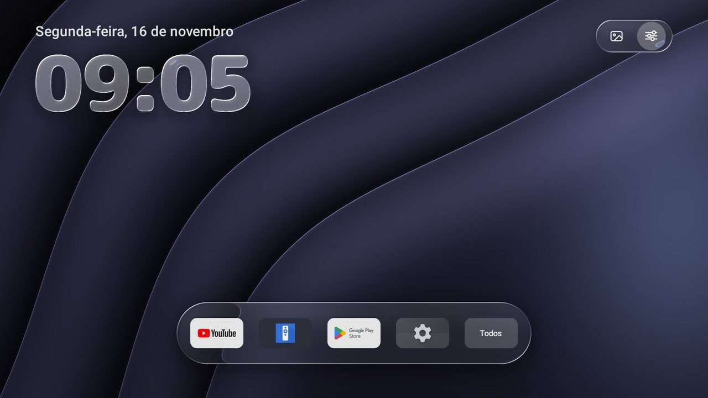 | 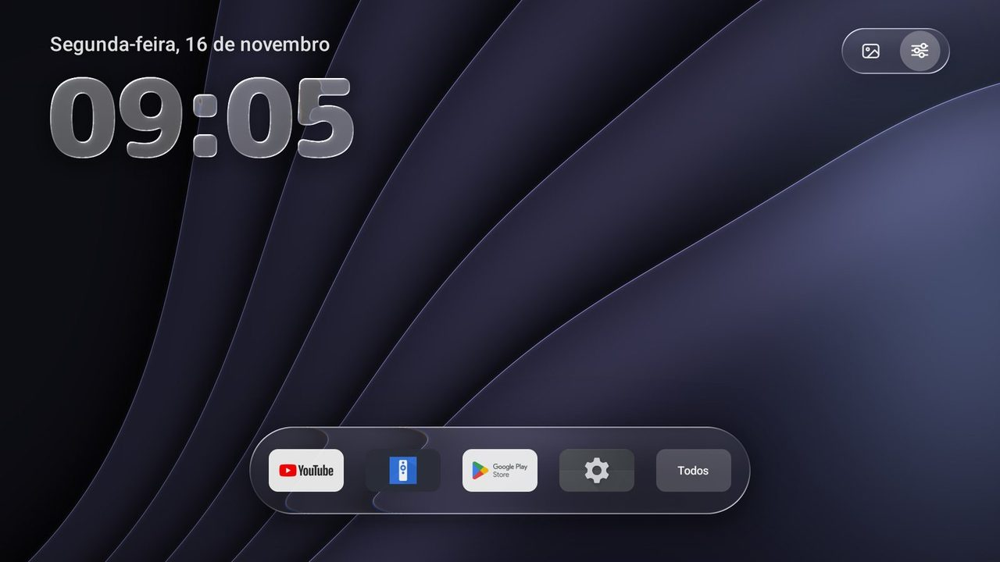 |
| **Ondas**, o padrão. Desenho original. | **Leque.** Desenho original. |
| 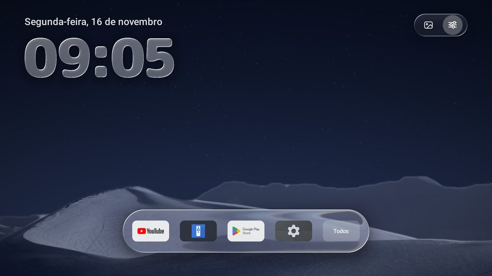 | 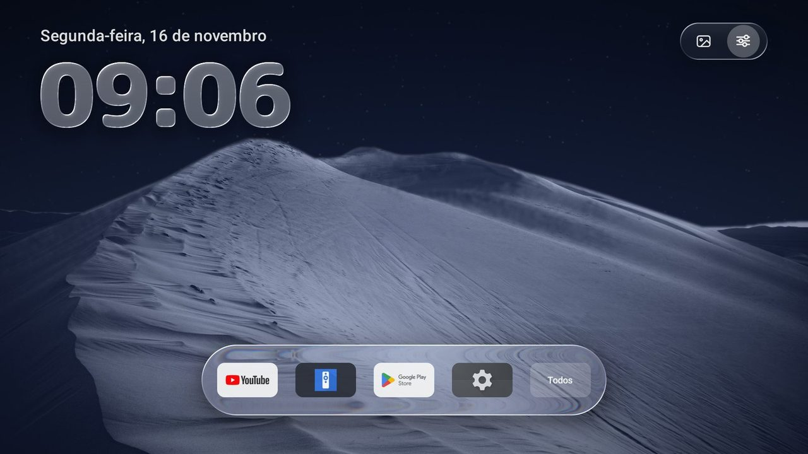 |
| **Luar.** Foto de domínio público das Dumont Dunes, virada noite. | **Crista.** Outra foto das Dumont Dunes, também virada noite. |

Além deles: Órbita, Dunas, Aurora e Seda (desenhados pelo próprio Vitro) e fotos e obras de domínio público.

## O que é desativado em cada sistema

O Vitro usa uma lista para cada sistema. A primeira configuração só oferece o que está instalado e ativo na sua
TV.

- **Fire OS:** [`launcher/debloat.txt`](launcher/debloat.txt). Anúncios, recomendações, telemetria e extras da
  Amazon (29 recomendados), mais alguns apps da Amazon. A **Alexa** e o controle por voz nunca são desativados.
- **Android TV e Google TV:** [`launcher/debloat-androidtv.txt`](launcher/debloat-androidtv.txt). Recomendações e
  anúncios da tela inicial, relatórios enviados ao Google, o modo ambiente com conteúdo promovido e, nas TVs
  **TCL**, os apps de conteúdo, anúncios e coleta de dados da própria TCL. O **Assistente** e a busca por voz nunca
  são desativados. Também nunca entram: Play Store e serviços do Google, o assistente de configuração, as entradas
  HDMI, o sintonizador e a TV ao vivo, os ajustes de imagem e som, o controle remoto, o teclado e as telas iniciais
  do sistema.

O Chromecast integrado, o app Google TV e o YouTube só aparecem no diagnóstico, desmarcados: muita gente usa.

## Desfazer

- **Um app desativado:** Configurações › Apps (ou Aplicativos) › o app › Ativar. Pelo computador:
  `adb shell pm enable <pacote>`.
- **Botão Home:** Configurações › Acessibilidade › Vitro › desligar. O autorreparo religa o serviço quando a TV
  liga; para desligar de vez, desinstale o Vitro.
- **Prime Video sob demanda (Fire OS):** antes de desinstalar o Vitro, `adb shell pm enable com.amazon.firebat`.
- **Tudo:** desinstale o Vitro. A autorização da chave sai em Opções do desenvolvedor › Revogar autorizações de
  depuração. Os apps desativados continuam desativados até você ativá-los.

## Desligar a TV pela voz (Fire TV)

A Alexa da Fire TV não aceita "timer de desligamento", mas aceita rotinas com espera. No app Alexa do celular, vá
em Mais › Rotinas › +:

1. **Quando:** Voz, com a frase `desligar tv em trinta minutos` (números por extenso; o app não aceita algarismos).
2. **Alexa vai:** Aguarde, 30 minutos.
3. **Alexa vai:** Personalizar, com o texto `desligar a TV`.
4. Salvar. Repita com outras frases e tempos (quinze minutos, uma hora...).

Quando a rotina manda "desligar a TV", o Vitro põe o Fire TV para dormir. Se a sua TV aceita HDMI-CEC (Anynet+,
SIMPLINK, BRAVIA Sync...), ela desliga junto. Se não aceita, ligue nela o desligamento automático sem sinal (nas
Samsung, Sistema › Solução Ecológica › Espera sem Sinal).

## Apoie o projeto

O Vitro é gratuito e continua sendo. Se ele ajudou a sua TV e você quiser apoiar, aponte a câmera do celular para o QR
Code do PIX (qualquer valor):


Chave aleatória: `dcbc1400-a4d6-4565-b047-b52c2e4ed641`

O mesmo QR Code aparece no app, em Ajustes › Sobre. Fora do Brasil, o apoio pelo **GitHub Sponsors** fica no botão
"Sponsor" no topo desta página.

## Compilar

Precisa do Java 17 e do Android SDK (`platforms;android-34` e `build-tools;34.0.0`). Sem Gradle:

```
cd launcher
sh build.sh
```

O APK sai em `launcher/out/vitro.apk`. No primeiro build, o `build.sh` cria uma chave de assinatura em
`launcher/key.jks`: guarde-a, porque atualizações precisam da mesma chave. Ela nunca deve ir para o repositório.

Scripts para usar do computador (passe o IP da TV): `instalar.sh`, `restaurar.sh` (refaz permissões e ajustes
depois de um reset), `debloat.sh` (desativa e reativa por grupo, no Fire OS), `medir-fluidez.sh` e
`medir-memoria.sh`. As prévias das telas e dos sons ficam em `prototipo/`.

## Créditos

- Ideias e técnicas de projetos livres para Fire TV: FireFrame e TV Detox (build sem Gradle e lista do debloat,
  licença MIT), dumbtv e firetv-home-guard (alarme imediato para o Home), Homestead (leitura do registro para
  perceber o Home e a VPN local).
- Listas do Android TV conferidas no Universal Android Debloater (UAD-ng) e em guias públicos de debloat de Google
  TV, Shield e TCL.
- Fonte do relógio: M PLUS Rounded 1c, licença SIL Open Font License (`launcher/assets/fonts/OFL.txt`).
- Papéis de parede: fotos e obras de domínio público ou CC0, mais dois desenhos originais (Leque e Ondas), com
  fontes em [`launcher/assets/wallpapers/CREDITS.md`](launcher/assets/wallpapers/CREDITS.md). Luar e Crista são
  fotos das Dumont Dunes (deserto de Mojave) do Bureau of Land Management, transformadas em noite. Os programas
  que geram esses quatro estão em [`wallpapers-src/gerar/`](wallpapers-src/gerar/).
- Sons de navegação: feitos do zero por síntese, sem gravações de terceiros, por
  [`prototipo/gerar-sons.py`](prototipo/gerar-sons.py) (prévia das quatro famílias em `prototipo/sons.html`).

## Licença

[MIT](LICENSE): use, modifique e redistribua à vontade, mantendo o aviso de autoria. O Vitro vem sem garantia: ele
desativa apps do sistema, e cada pessoa decide o que desativar na própria TV. Os créditos e as licenças de terceiros
estão em [THIRD_PARTY_NOTICES.md](THIRD_PARTY_NOTICES.md).
