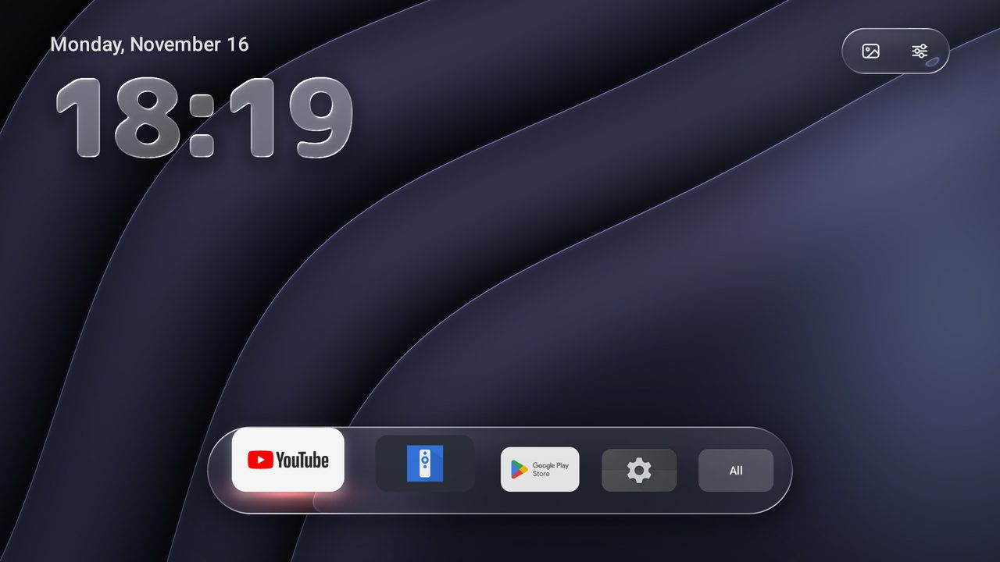
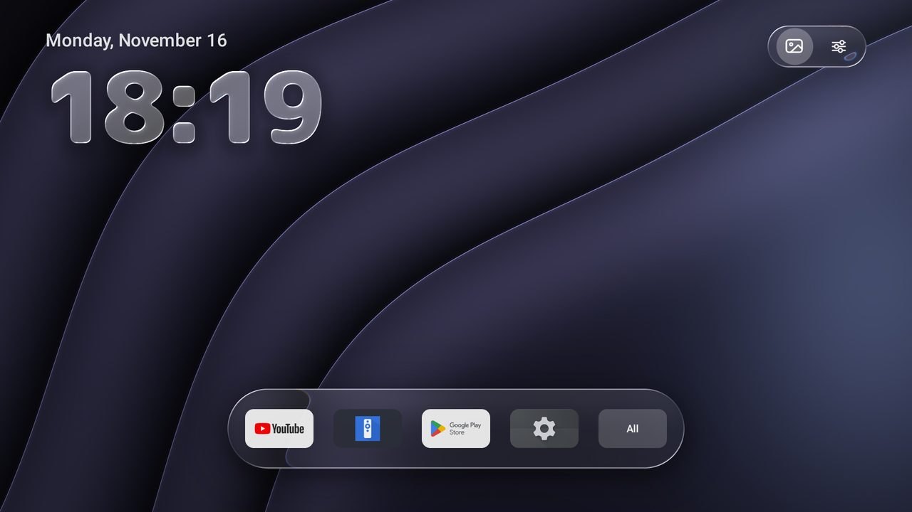
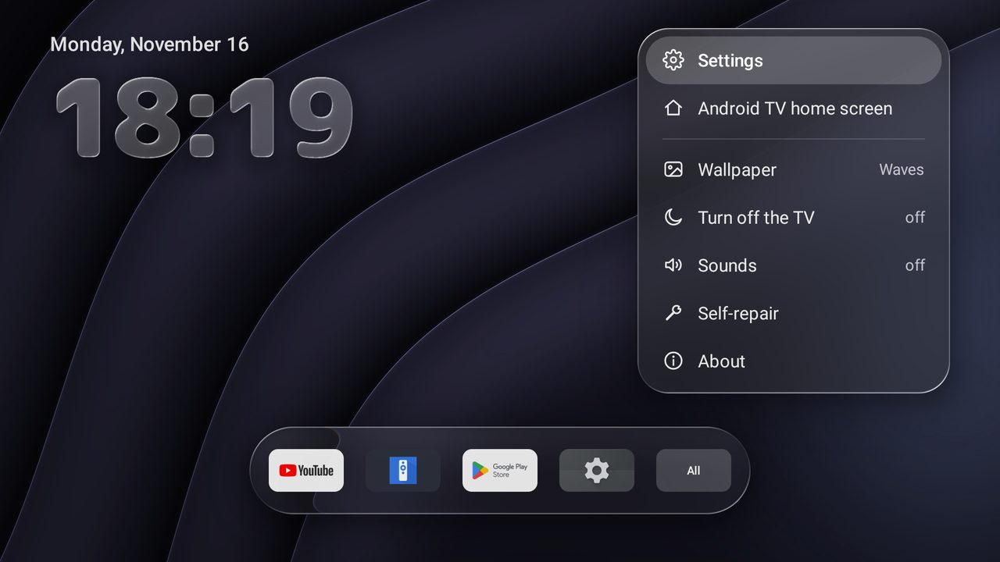
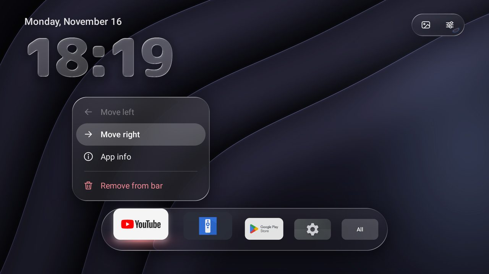
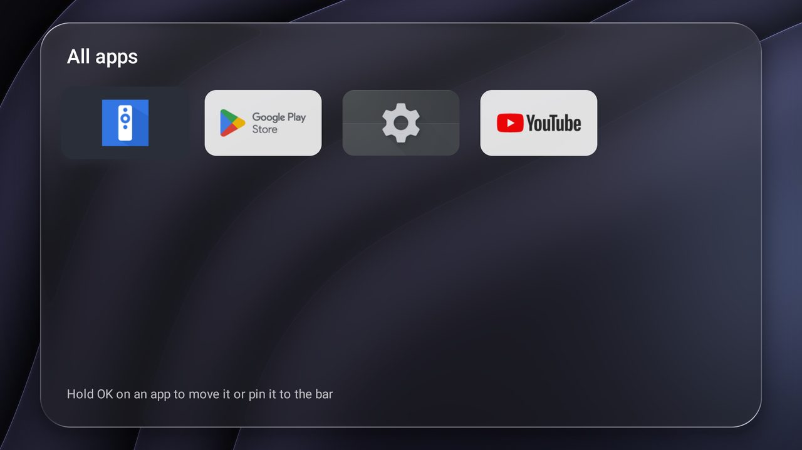
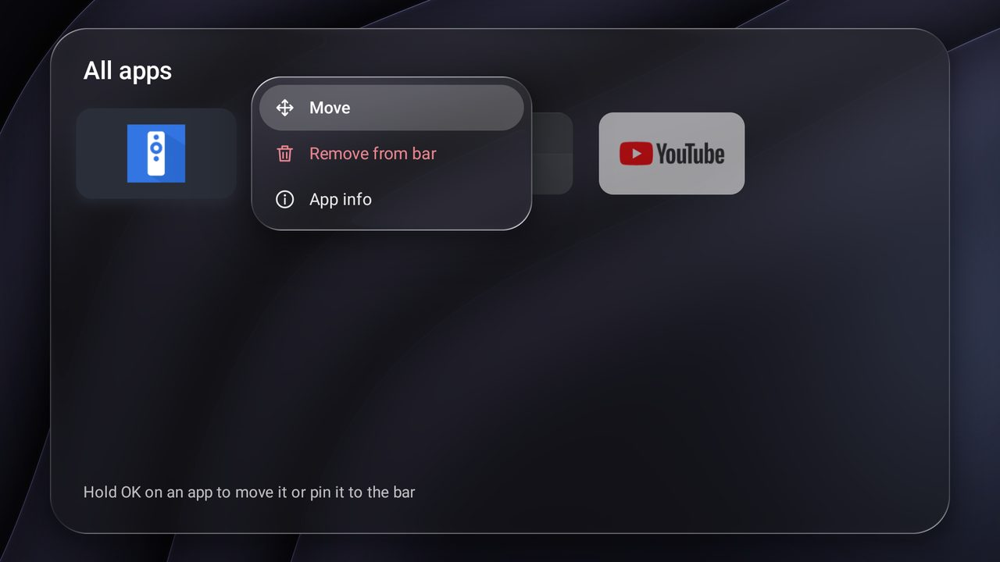
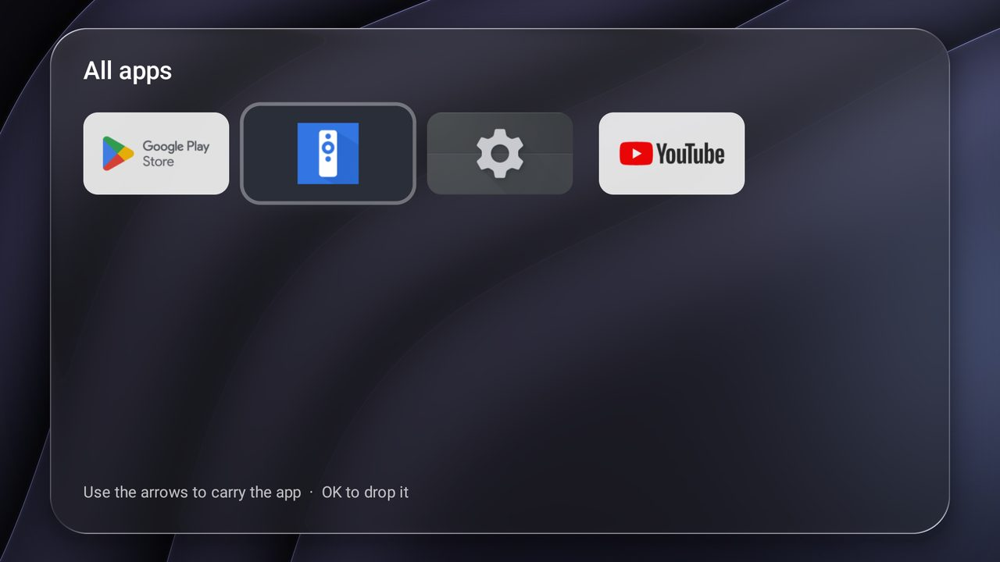
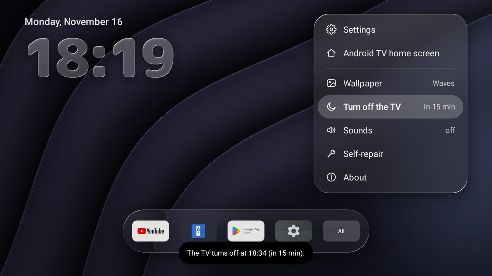
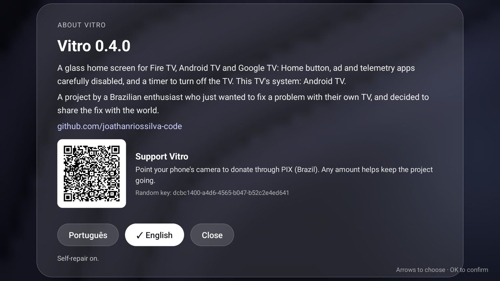

# Vitro tutorial

*Português: [TUTORIAL.md](TUTORIAL.md).* To install and run the first-time setup, see the [README](README.en.md).

Everything in Vitro is done with the remote: the arrows, OK and Back.

## Remote buttons

| Button | What it does in Vitro |
|---|---|
| **← →** | Moves along the app bar. The focused app grows, like under a magnifier. |
| **↑** | Goes up to the two icons in the top corner: wallpaper and settings. |
| **↓** | Goes back to the bar. |
| **OK** | Opens the focused app, or picks the line of the open menu. |
| **Hold OK** (or the ☰ button, if your remote has one) | Opens the focused app's menu: move, app info, remove from bar. |
| **Back** | Closes the open menu or the app drawer. |
| **Home** | From any app, brings Vitro back. |

## Home screen

At the top, the date and the glass clock. At the bottom, the bar with your apps. The last item, **All**, opens the
drawer with everything installed.

## Change the wallpaper

Press **↑** and stay on the first icon in the corner (the picture). Each **OK** switches to the next wallpaper. The
*Wallpaper* line in settings does the same.

## Settings

Press **↑**, go to the second icon in the corner and press **OK**.

| Line | What it does |
|---|---|
| **Settings** | Opens the TV's system settings. |
| **System home screen** | Opens the Amazon, Google TV or Android TV home screen. Vitro does not switch it back while you are there; Home brings Vitro again. |
| **Wallpaper** | Each OK moves to the next one. The current name shows on the right. |
| **Turn off the TV** | Timer: each OK goes through 15, 30, 60 and 90 minutes and off (see below). |
| **Sounds** | Turns navigation sounds on or off (a short tap when moving, confirming and going back). Off by default. |
| **Self-repair** | Checks and redoes what a system update may have undone: the Home button service, debugging, permissions and disabled apps. |
| **About** | Version, credits, language and supporting the project. |

## Arrange the bar

With the focus on an app in the bar, **hold OK**:

- **Move left / right:** changes the app's place on the bar.
- **App info:** opens the app's page in settings (to clear data, uninstall, etc.).
- **Remove from bar:** the app leaves the bar but stays installed and in the drawer.

## All apps

The last item on the bar, **All**, opens the drawer. The arrows move around the grid, **OK** opens the app and **Back**
closes the drawer.

In the drawer, **hold OK** on an app:

- **Move:** the app is lifted; the arrows carry it around the grid and **OK** drops it in the new place.
- **Pin to bar / Remove from bar:** puts the app on the bar, or takes it off.
- **App info:** the app's page in settings.

## Sleep timer

In **Settings › Turn off the TV**, each **OK** picks 15, 30, 60 or 90 minutes (or off). One minute before, a notice
shows on screen. At the time, Vitro puts the device to sleep. If your TV supports HDMI-CEC it turns off too; if not,
turn on its automatic power-off when there is no signal.

## About and supporting the project

In **Settings › About**: the version, the credits and the **Português / English** buttons, which switch the whole
app's language right away. Below, the QR code to support the project through PIX (Brazil's instant payments): point
your phone's camera at it.

## If something stops working

- **Home goes to the system screen again:** open Vitro and use **Settings › Self-repair**.
- **An app is missing from the drawer:** it may be disabled. Enable it in Settings › Apps › the app › Enable.
- **To undo everything:** see [Undo](README.en.md#undo) in the README.
