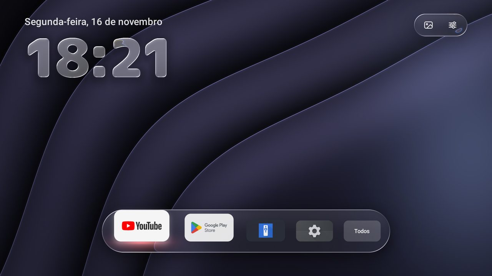
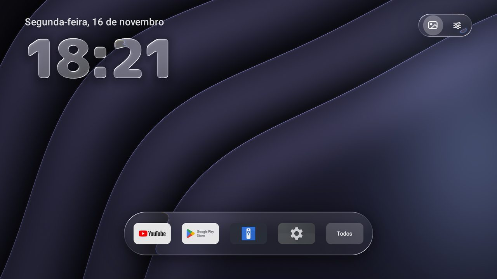
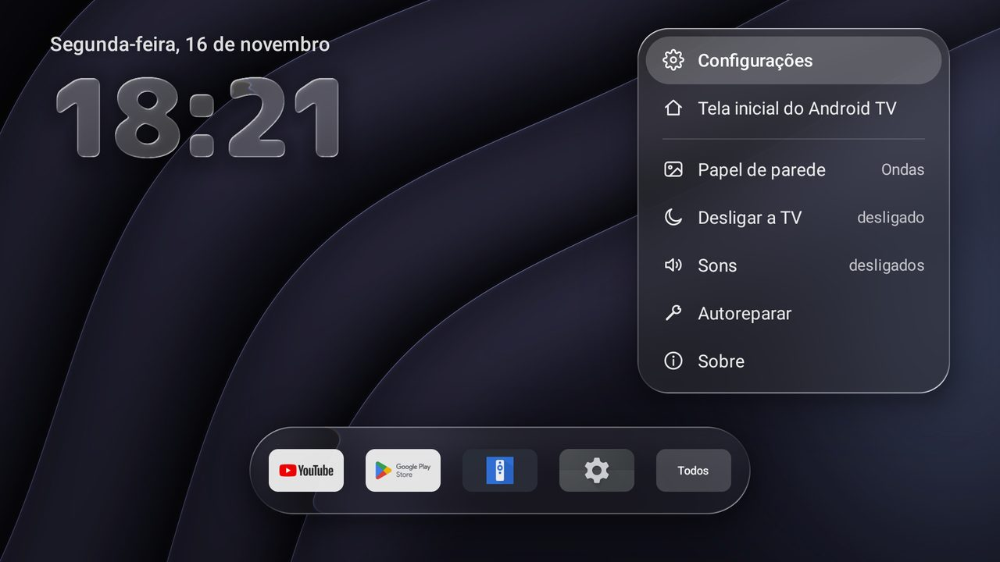
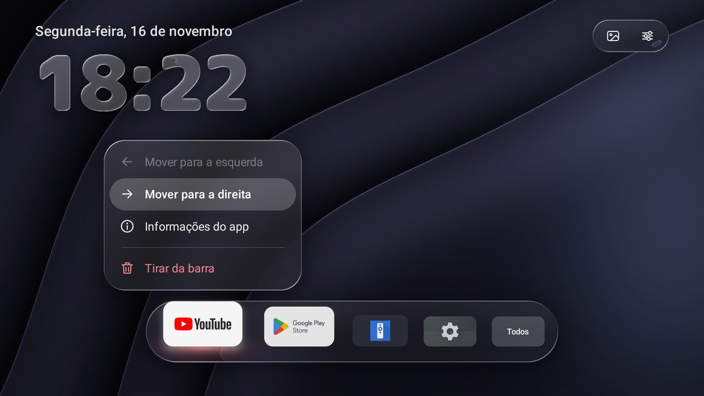
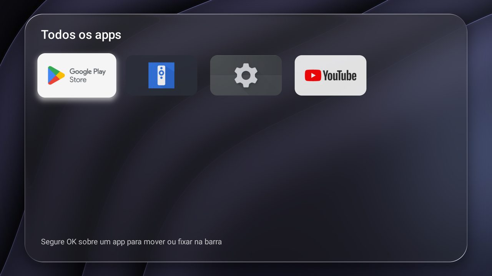
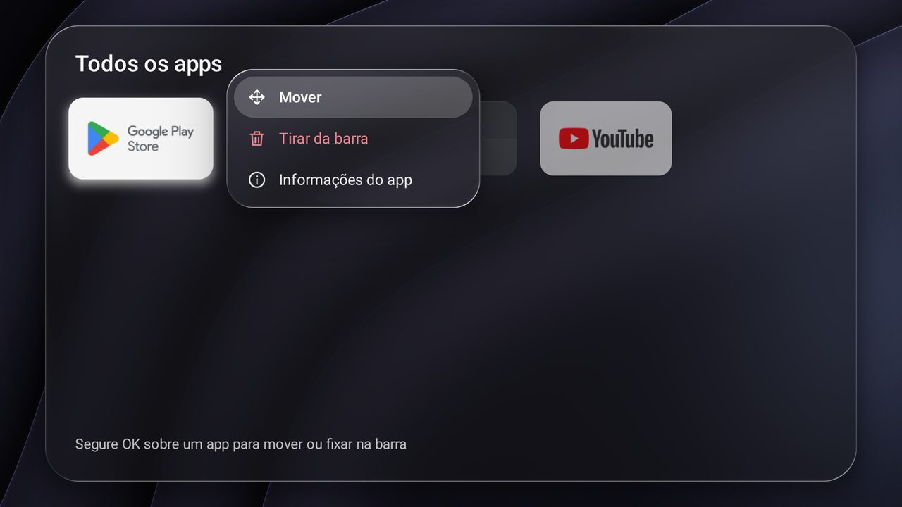
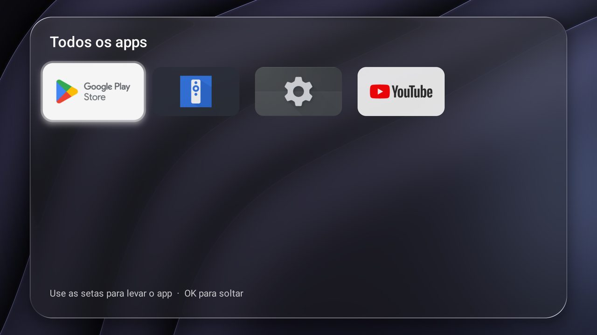
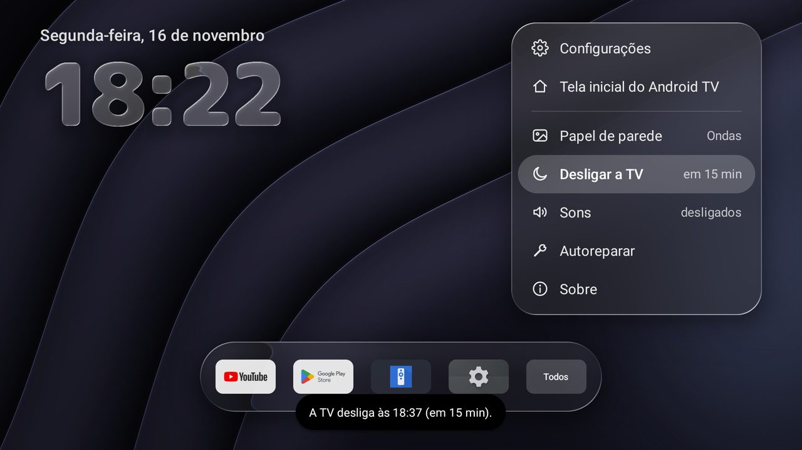

# Tutorial do Vitro

*English: [TUTORIAL.en.md](TUTORIAL.en.md).* Para instalar e fazer a primeira configuração, veja o [README](README.md).

Tudo no Vitro se faz com o controle remoto: as setas, o OK e o Voltar.

## Os botões do controle

| Botão | O que faz no Vitro |
|---|---|
| **← →** | Anda pela barra de apps. O app em foco cresce, como numa lupa. |
| **↑** | Sobe para os dois ícones do canto de cima: papel de parede e ajustes. |
| **↓** | Volta para a barra. |
| **OK** | Abre o app em foco, ou escolhe a linha do menu aberto. |
| **OK segurado** (ou o botão ☰, se o controle tiver) | Abre o menu do app em foco: mover, informações, tirar da barra. |
| **Voltar** | Fecha o menu ou a gaveta aberta. |
| **Home** | De qualquer app, volta para o Vitro. |

## Tela inicial

Em cima, a data e o relógio de vidro. Embaixo, a barra com os seus apps. O último item, **Todos**, abre a gaveta com
tudo o que está instalado.

## Trocar o papel de parede

Aperte **↑** e fique no primeiro ícone do canto (a imagem). Cada **OK** troca para o próximo papel de parede. O mesmo
vale para a linha *Papel de parede* dos ajustes.

## Ajustes

Aperte **↑**, vá ao segundo ícone do canto e aperte **OK**.

| Linha | O que faz |
|---|---|
| **Configurações** | Abre as configurações do sistema da TV. |
| **Tela inicial do sistema** | Abre a tela inicial da Amazon, do Google TV ou do Android TV. O Vitro não a troca de volta enquanto você estiver nela; o Home traz o Vitro de novo. |
| **Papel de parede** | Cada OK passa para o próximo. O nome do atual aparece à direita. |
| **Desligar a TV** | Timer: cada OK passa por 15, 30, 60 e 90 minutos e desligado (veja abaixo). |
| **Sons** | Liga ou desliga os sons de navegação (um toque curto ao mover, confirmar e voltar). Vem desligado. |
| **Autoreparar** | Confere e refaz o que uma atualização do sistema pode ter desfeito: o serviço do botão Home, a depuração, as permissões e os apps desativados. |
| **Sobre** | Versão, créditos, idioma e apoio ao projeto. |

## Organizar a barra

Com o foco num app da barra, **segure OK**:

- **Mover para a esquerda / direita:** troca o app de lugar na barra.
- **Informações do app:** abre a tela do app nas configurações (para limpar dados, desinstalar etc.).
- **Tirar da barra:** o app sai da barra, mas continua instalado e na gaveta.

## Todos os apps

O último item da barra, **Todos**, abre a gaveta. As setas andam pela grade, **OK** abre o app e **Voltar** fecha a gaveta.

Na gaveta, **segure OK** sobre um app:

- **Mover:** o app fica levantado; as setas o levam pela grade e **OK** o solta no lugar novo.
- **Fixar na barra / Tirar da barra:** põe o app na barra, ou tira.
- **Informações do app:** a tela do app nas configurações.

## Timer para desligar a TV

Em **Ajustes › Desligar a TV**, cada **OK** escolhe 15, 30, 60 ou 90 minutos (ou desligado). Um minuto antes aparece um
aviso na tela. Na hora, o Vitro põe o aparelho para dormir. Se a TV aceita HDMI-CEC, ela desliga junto; se não, ligue
nela o desligamento automático sem sinal.

## Sobre e apoio ao projeto

Em **Ajustes › Sobre**: a versão, os créditos e os botões **Português / English**, que trocam o idioma do app inteiro na
hora. Embaixo, o QR Code para apoiar o projeto pelo PIX: aponte a câmera do celular.

## Se algo parar de funcionar

- **O Home voltou para a tela do sistema:** abra o Vitro e use **Ajustes › Autoreparar**.
- **Um app sumiu da gaveta:** ele pode estar desativado. Ative em Configurações › Apps › o app › Ativar.
- **Quer desfazer tudo:** veja [Desfazer](README.md#desfazer) no README.
